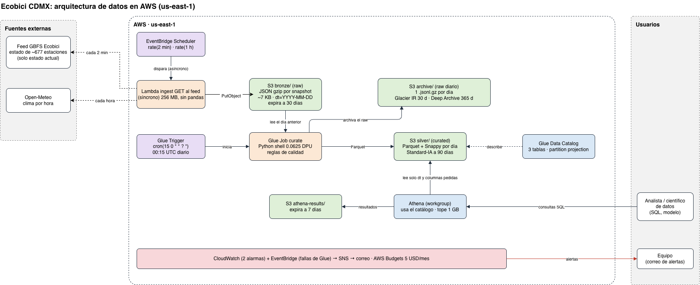

# E2 · Ecobici Cloud: predicción de disponibilidad por estación

**Perfil técnico:** Ivonne Enciso · **Perfil funcional:** Emiliano
**Repositorio:** código en la raíz del repo; este folder contiene el entregable y sus evidencias.

## Índice: dónde está cada cosa

| Qué buscas | Dónde está |
|---|---|
| Este documento (respuestas de la tarea) | [`E2/README.md`](README.md) |
| Diagrama de arquitectura (imagen editable en draw.io) | [`E2/diagramas/arquitectura_ecobici.drawio.png`](diagramas/arquitectura_ecobici.drawio.png) |
| Evidencias: consultas de Athena con bytes | [`E2/evidencias/athena_consultas.md`](evidencias/athena_consultas.md) |
| Evidencias: las 3 capas en S3 | [`E2/evidencias/capas_s3.md`](evidencias/capas_s3.md) |
| Evidencias: corridas del Job de Glue | [`E2/evidencias/glue_corridas.md`](evidencias/glue_corridas.md) |
| Evidencias: ingesta automática | [`E2/evidencias/ingesta.md`](evidencias/ingesta.md) |
| Evidencias: ciclo de vida (costos) | [`E2/evidencias/ciclo_de_vida.json`](evidencias/ciclo_de_vida.json) |
| Evidencias: costo real en AWS | [`E2/evidencias/costos_reales.md`](evidencias/costos_reales.md) |
| Kit con cifras para la Ruta 2 | [`docs/E2_kit_funcional.md`](../docs/E2_kit_funcional.md) |
| Infraestructura completa (AWS SAM) | [`template.yaml`](../template.yaml) |
| Job de Glue (raw → curated) | [`glue/curate_job.py`](../glue/curate_job.py) |
| Código de ingesta y limpieza | [`src/ecobici/`](../src/ecobici/) |
| Pruebas automáticas | [`tests/`](../tests/) |
| Guía para desplegar | [`docs/DESPLIEGUE.md`](../docs/DESPLIEGUE.md) |

## Resumen

Capturamos cada 2 minutos el estado de las ~677 estaciones de Ecobici (feed público GBFS) y el clima por hora (Open-Meteo). Los datos llegan crudos a S3. Un Job de Glue los convierte cada noche en Parquet particionado por fecha y se consultan con SQL en Athena. Todo está desplegado en AWS (us-east-1) con infraestructura como código (`template.yaml`, AWS SAM), monitoreo con alertas por correo y un presupuesto mensual. Costo real: **0.054 USD en los primeros 9 días** (≈ 2.19 USD proyectado a 12 meses).

```
EventBridge Scheduler ─(cada 2 min)─► Lambda ingest ─► S3 bronze/  (raw: JSON gzip por snapshot)
                      ─(cada hora)──► Lambda ingest ─► S3 bronze/weather/
Glue Trigger ─(00:15 UTC)─► Glue Job curate ─► S3 silver/  (curated: 1 Parquet por tabla y día)
                                          └──► S3 archive/ (raw del día en 1 archivo, para Glacier)
Glue Data Catalog (partition projection) ─► Athena (workgroup con tope) ─► S3 athena-results/
CloudWatch + EventBridge ─► SNS ─► correo          AWS Budgets ─► correo
```

---

## Ruta 1 · Técnica (construido en AWS)

### 1. Lago con 3 capas

| Capa del enunciado | Prefijo en S3 | Contenido | Formato |
|---|---|---|---|
| raw | `bronze/` | Un archivo por snapshot (estado de estaciones), por consulta de clima y catálogo diario, tal cual llegó | JSON gzip |
| raw (archivo) | `archive/` | El raw de cada día en un solo archivo, para conservarlo barato | JSONL gzip |
| curated | `silver/` | `fact_station_status`, `dim_station`, `fact_weather_hourly`: un Parquet por tabla y día | Parquet + Snappy |
| resultados | `athena-results/` | Resultados de las consultas de Athena | CSV |

Todas las capas se particionan por fecha UTC (`dt=YYYY-MM-DD/`). Evidencia: [`evidencias/capas_s3.md`](evidencias/capas_s3.md).

**Tres consultas en Athena con los bytes anotados:** [`evidencias/athena_consultas.md`](evidencias/athena_consultas.md).

| Consulta | Bytes escaneados | Lectura |
|---|---|---|
| Q1. Calidad por hora de un día (con filtro de partición) | 58.3 KB | Lee 1 día y 2 columnas |
| Q2. La misma, sin filtro de partición | 394.3 KB (6.8 veces Q1) | Lee todos los días: muestra el ahorro del particionado |
| Q3. Estaciones que más tiempo pasaron vacías (JOIN) | 521.6 KB | Consulta de negocio |

Athena cobra un mínimo de 10 MB por consulta, así que hoy cada una cuesta lo mismo (~0.00005 USD). La diferencia entre Q1 y Q2 sí importa a futuro: Q2 crece con cada día acumulado y Q1 no. Con un año de datos, Q2 leería ~365 veces más que Q1. Por su parte, la corrida del Job de Glue tardó 54 s y costó ~0.0004 USD.

### 2. Tablas con datos estructurados

Tres tablas en el **Glue Data Catalog**, consultables en **Athena** (base `ecobici`). Usan *partition projection*, así que no requieren crawlers ni `MSCK REPAIR`.

| Tabla | Grano | Columnas clave |
|---|---|---|
| `fact_station_status` | estación × snapshot (cada 2 min) | bicis y anclajes disponibles, estado, 7 banderas de calidad `dq_*`, `en_horario` |
| `dim_station` | estación × día | `short_name` (llave con los viajes), nombre, coordenadas, capacidad |
| `fact_weather_hourly` | hora | temperatura, lluvia, viento, código de clima |

**DynamoDB no se usa en esta etapa.** Hoy todas las consultas son por lotes (análisis y entrenamiento). DynamoDB entra cuando exista la consulta en tiempo real "predicción de la estación X". Ver el ADR de almacenamiento en la Ruta 2.

### 3. Job de Glue: raw → curated en Parquet particionado

- **Job:** `ecobici-cloud-curate`, Glue **Python shell**, 0.0625 DPU (la capacidad mínima), timeout de 30 min, 1 reintento. Código: [`glue/curate_job.py`](../glue/curate_job.py).
- **Lógica:** reutiliza el módulo probado `ecobici.aws.compact` (32 pruebas automáticas, incluido un día completo simulado en S3).
  1. Lee los ~720 snapshots del día en `bronze/`.
  2. Aplica las reglas de calidad snapshot por snapshot y marca el horario de operación.
  3. Escribe un Parquet por tabla en `silver/<tabla>/dt=<día>/part-00000.parquet`.
  4. Archiva el raw del día en `archive/`.
  - Es idempotente: se puede reprocesar cualquier día con `--DATE 2026-11-12`.
- **Disparo:** Glue Trigger programado, `cron(15 0 * * ? *)` (00:15 UTC = 18:15 en CDMX).
- **Aviso de fallas:** una regla de EventBridge (`Glue Job State Change` = FAILED/TIMEOUT/ERROR) publica en SNS y llega por correo.
- **Por qué Python shell y no Spark:** el volumen diario es de ~5 MB. Spark exige mínimo 2 DPU y costaría ~10.70 USD al año, contra ~0.33 USD de Python shell. Ver el ADR de procesamiento.

Evidencia: [`evidencias/glue_corridas.md`](evidencias/glue_corridas.md).

### 4. Políticas para optimizar costos

**Almacenamiento**

| Política | Dónde | Por qué |
|---|---|---|
| Expiración a 30 días | `bronze/` | Los JSON individuales pesan ~7 KB y S3 no transiciona a Glacier objetos de menos de 128 KB. El raw no se pierde: queda en `archive/` |
| Glacier Instant Retrieval a 30 días; Deep Archive a 365 | `archive/` | El raw solo se relee para reprocesar; un archivo por día supera los 128 KB |
| Standard-IA a 90 días | `silver/` | Lo reciente se consulta seguido; lo viejo, casi nunca |
| Expiración a 7 días | `athena-results/` | Los resultados se pueden regenerar |
| Abortar cargas incompletas a 1 día | todo el bucket | Evita pagar por fragmentos huérfanos |
| Parquet + Snappy, particionado por `dt` | `silver/` | Athena lee solo los días y columnas que pide la consulta |
| Retención de logs de 14 días | CloudWatch | Los logs no se acumulan indefinidamente |

Reglas vigentes: [`evidencias/ciclo_de_vida.json`](evidencias/ciclo_de_vida.json).

**Procesamiento**

| Política | Por qué |
|---|---|
| La Lambda de ingesta no usa pandas (256 MB, solo librería estándar) | Corre 744 veces al día: un paquete de pocos KB arranca rápido y cuesta menos |
| Un solo Job de Glue al día, en Python shell a 0.0625 DPU | El volumen no justifica Spark |
| Workgroup de Athena con tope de 1 GB por consulta | Una consulta mal escrita cuesta como máximo ~0.005 USD |
| Partition projection en lugar de crawlers | Sin costo de crawler ni pasos manuales para registrar particiones |
| AWS Budgets a 5 USD al mes, sin descontar créditos | Aviso al 80% del gasto real y si el pronóstico supera el presupuesto |

---

## Eventos (triggers) de ingesta

**A. Evento que dispara la llegada del dato.** Una **programación (cron)**. El feed GBFS solo publica el estado actual: no avisa cuando cambia, ni deja archivos, ni ofrece un flujo continuo. Hay que ir a buscarlo periódicamente.

| Flujo | Evento | Servicio |
|---|---|---|
| Estado de estaciones | `rate(2 minutes)` | EventBridge Scheduler → Lambda `ingest` (`{"task": "status"}`) |
| Clima | `rate(1 hour)` | EventBridge Scheduler → Lambda `ingest` (`{"task": "weather"}`) |
| raw → curated | `cron(15 0 * * ? *)` | Glue Trigger → Job `curate` |

**B. Clasificación.**
- **Invocación asíncrona:** el Scheduler dispara la Lambda y no espera su respuesta. Lambda gestiona el reintento (1 reintento, descartado si el evento tiene más de 120 s).
- **Consulta a la fuente síncrona:** dentro de la Lambda, la petición HTTP al feed espera la respuesta (timeout de 15 s, 3 intentos con backoff de 1 y 2 s).
- **Job de Glue asíncrono:** el trigger lo arranca y su resultado se notifica por evento (EventBridge → SNS).

**C. Justificación con cifras.**

| | Estado de estaciones | Clima |
|---|---|---|
| Frecuencia de cambio en la fuente | el feed se regenera cada ~60 s (`ttl`) | horaria |
| Frecuencia elegida | cada 2 min (720 al día) | cada hora (24 al día) |
| Volumen | ~7 KB comprimido por snapshot; ~5 MB/día | <1 KB por consulta |
| Tiempo de respuesta esperado | dato en S3 en <5 s tras el disparo; curated al día siguiente (T+1) | igual |
| Por qué no más seguido | cada 1 min duplica costo y volumen; la duración mediana de un viaje es de 12 min, así que 2 min captura los cambios relevantes | el clima de Open-Meteo es horario |

**¿Qué pasa si la fuente falla?**
1. La Lambda reintenta 3 veces la petición HTTP y, si sigue fallando, termina en error. Lambda la reintenta una vez más.
2. **Alarma 1:** si hay 3 o más errores en 10 minutos, llega un correo.
3. **Alarma 2:** si no hay ninguna ejecución en 15 minutos (el scheduler o la función están detenidos), llega un correo.
4. **Un snapshot perdido no se puede recuperar,** porque el feed solo da el estado actual. Por eso el Job de Glue mide y reporta la completitud del día (snapshots recibidos / 720) y los huecos de más de 5 minutos, y el modelo lo tolera.
5. El clima sí se puede recuperar después desde la API histórica de Open-Meteo.

**Diagrama de la arquitectura de ingesta** (la imagen también es editable: ábrela en app.diagrams.net):



**D. Construcción y prueba.** Implementado en `template.yaml` y `src/ecobici/aws/`. Pruebas:
- Automáticas (`python -m pytest`, 32 pruebas): un día completo de ingesta (720 snapshots + 24 consultas de clima) contra S3 simulado, compactación, idempotencia, esquema Parquet = tablas de Athena, ciclo de vida y compatibilidad del job con Python 3.9.
- En la nube: completitud medida en [`evidencias/glue_corridas.md`](evidencias/glue_corridas.md) y triggers activos en [`evidencias/ingesta.md`](evidencias/ingesta.md).

---

## Ruta 2 · Funcional (decide y documenta)

Secciones a cargo del perfil funcional (Emiliano). Las cifras vienen de [`docs/E2_kit_funcional.md`](../docs/E2_kit_funcional.md) y de las [`evidencias/`](evidencias/).

### 1. Zonas y regiones

**Decisión: una sola región, us-east-1 (Norte de Virginia), con varias zonas de disponibilidad (AZ) y sin replicación a otra región por ahora.**

| Pregunta | Decisión | Por qué |
|---|---|---|
| ¿Qué región? | us-east-1 | Es de las regiones más baratas y tiene todos los servicios que usamos (Lambda, EventBridge Scheduler, S3, Glue, Athena, SNS, Budgets) |
| ¿Por qué no Mexico (Central) `mx-central-1`? | No se usa | Cuesta más, y solo tendría sentido si una regla exigiera que los datos se queden en México. No es nuestro caso: los datos son públicos (feed GBFS y clima) y no hay datos personales en la nube |
| ¿Cuántas zonas (AZ)? | Varias, sin costo extra | S3 Standard guarda cada objeto en al menos 3 AZ (durabilidad de 99.999999999%). Lambda, Glue y Athena son servicios regionales que AWS ya corre en varias AZ. No tenemos servidores que repartir entre zonas |
| ¿Replicar a otra región (CRR)? | **No, por ahora** | Costaría menos de 0.10 USD al año, pero protege contra un riesgo muy poco probable: perder S3 en toda una región. Además, si se cae us-east-1, la ingesta se detiene igual, porque la Lambda y el Scheduler también viven ahí. Para que la réplica sirviera habría que duplicar todo el stack. Los riesgos reales son una ingesta detenida o un borrado accidental. Para la ingesta detenida tenemos dos alarmas por correo (errores y "sin ejecuciones en 15 min"). Para el borrado, el bucket tiene `DeletionPolicy: Retain` y el raw consolidado se guarda en `archive/` |

**Condición de cambio:** si el histórico se vuelve un producto con usuarios externos o con un compromiso de disponibilidad (SLA), activamos la replicación (CRR) de `silver/` y `archive/` a us-west-2. Lo mismo si una norma nos obliga a guardar los datos en México: en ese caso migramos a `mx-central-1`.

### 2. Caso de uso de la nube: tres razones frente a un centro de datos propio

| # | Razón | Ejemplo concreto en Ecobici Cloud |
|---|---|---|
| 1 | **Pago por uso, sin inversión inicial** | El costo real fue de 0.054 USD en 9 días (≈ 2.19 USD al año) y el estimado más alto es de 5.92 USD al año. En un centro de datos propio habría que comprar un servidor y tenerlo encendido 24/7. Solo la luz de un año costaría más que todo el sistema en la nube, aunque la captura solo trabaja 1 a 2 s cada 2 minutos |
| 2 | **Servicios administrados para un equipo de 2 personas** | No hay sistema operativo que parchar ni discos que cambiar. Lambda corre la ingesta (744 veces al día), Glue el procesamiento nocturno (54 s por corrida) y Athena las consultas con SQL. AWS opera los servidores; nosotros solo mantenemos el código y `template.yaml`, y todo se crea con un comando (`sam deploy`) |
| 3 | **Elasticidad: el costo crece con el uso, no por escalones de hardware** | Triplicar el volumen (x3: tres ciudades o tres veces las estaciones) no exige comprar nada: el costo anual pasa de ~5.92 a ~17.76 USD y la arquitectura es la misma. Si se agregan ciudades y luego se quitan, en la nube se deja de pagar; un servidor comprado se queda como costo hundido |

### 3. ADR de entrada y almacenamiento

**Título:** ADR-01 · Ingesta programada con EventBridge Scheduler + Lambda y almacenamiento en S3 (Parquet) consultado con Athena

**Contexto:** el feed de Ecobici solo publica el estado actual de ~677 estaciones (~7 KB comprimido), así que hay que consultarlo periódicamente y guardar cada foto para construir el histórico. Las consultas actuales son por lotes (análisis y entrenamiento), no en tiempo real.

**Decisión:** **confirmamos lo implementado.** EventBridge Scheduler dispara una Lambda cada 2 minutos (estado de estaciones) y cada hora (clima). La Lambda guarda el JSON tal cual en `bronze/` de S3. La capa curated se guarda en Parquet en `silver/` y se consulta con Athena.

¿Por qué?
- **La fuente define el tipo de entrada.** GBFS no empuja eventos ni ofrece un flujo continuo: hay que ir a pedir el dato. Un disparo programado es justo lo que se necesita. Kinesis (~29 USD/mes) resuelve un problema que no tenemos, porque está hecho para flujos continuos.
- **Costo y operación.** Lambda cuesta ~0.15 USD/mes y cada ejecución tarda 1 a 2 s, muy lejos del límite de 15 min. Un EC2 t4g.nano cuesta ~3 USD/mes (20 veces más) y además hay que parcharlo. Si ese servidor se cae, la captura se detiene, y un snapshot perdido no se puede recuperar.
- **El almacenamiento sigue al tipo de consulta.** Hoy todo es análisis por lotes con SQL, y S3 + Parquet + Athena cuesta ~0.25 USD/mes. DynamoDB costaría ~9 USD/mes (36 veces más) y no sirve para SQL analítico. RDS costaría ~12 USD/mes y estaría encendida 24/7 aunque nadie la consulte.

**Alternativas de entrada:**

| Alternativa | Costo/mes (x1) | Riesgo |
|---|---|---|
| EventBridge Scheduler + Lambda (implementado) | ~0.15 USD | Límite de 15 min por ejecución (hoy tarda 1–2 s) |
| EC2 t4g.nano con cron | ~3 USD + mantenimiento | Hay que parcharlo; si se cae, se detiene la captura |
| Kinesis Data Streams | ~29 USD | Sobredimensionado: la fuente no es un flujo continuo |

**Alternativas de almacenamiento:**

| Alternativa | Costo/mes (x1) | Riesgo |
|---|---|---|
| S3 + Parquet + Athena (implementado) | ~0.25 USD | Consultas en segundos, no en milisegundos |
| DynamoDB | ~9 USD (14.6 M escrituras/mes) | Caro para análisis por lotes; no sirve para SQL analítico |
| RDS PostgreSQL db.t4g.micro | ~12 USD | Encendida 24/7 aunque no se use; hay que administrarla |

**Consecuencias:**
- **Ganamos:** casi cero operación (no hay servidores), un costo de entrada y almacenamiento de ~0.40 USD/mes y crecimiento proporcional al volumen. Además, el raw se conserva intacto para reprocesar.
- **Perdemos:** las consultas tardan segundos, no milisegundos, y la capa curated está lista hasta el día siguiente (T+1). Esto sirve para análisis y entrenamiento, pero no para una app que responda "¿hay bicis en la estación X ahora?". Si la ingesta falla, ese snapshot se pierde para siempre.
- **Vigilamos:** la completitud diaria (snapshots recibidos / 720, la reporta el Job de Glue), las dos alarmas de ingesta y el costo de solicitudes a S3, que es el rubro más grande (ver el punto 6).

**Condición de cambio:**
- Si la frecuencia de captura baja a **menos de 1 minuto** o se agregan **más de 10 fuentes**, evaluamos Kinesis Data Streams.
- Si aparece una consulta por llave de **más de 1 millón de lecturas al día** (por ejemplo, una app que muestra la predicción por estación), agregamos DynamoDB solo para la última predicción de cada estación. S3 + Athena se queda para el histórico.

**Fecha y responsable:** 2026-11-18 · Emiliano (perfil funcional, dueño de datos) · Implementación: Ivonne Enciso (perfil técnico)

### 4. ADR de procesamiento (costo total a 12 meses, x1 y x3)

**Título:** ADR-02 · Transformación diaria raw → curated con un Job de Glue Python shell

**Contexto:** cada día llegan ~720 snapshots (~5 MB) que hay que limpiar, validar y convertir a Parquet particionado para consultarlos barato. El volumen es pequeño y el proceso corre una vez al día.

**Decisión:** **confirmamos lo implementado.** Un Job de Glue Python shell con 0.0625 DPU, disparado por un trigger diario a las 00:15 UTC. Las corridas registradas tardaron 51 y 54 s.

¿Por qué?
- **Es la opción más barata que alcanza:** 0.33 USD a 12 meses (x1) y 1.00 USD (x3). Glue Spark cuesta 10.70 / 32.10 USD (~32 veces más) por potencia distribuida que ~5 MB al día no necesitan. EMR supera los 100 USD.
- **Frente a Lambda (0.37 / 1.09 USD), que cuesta casi lo mismo,** Glue gana en lo operativo:
  - no tiene el tope de 15 min de Lambda (el job tiene un timeout de 30 min);
  - trae trigger programado y reintento propios;
  - avisa de fallas por EventBridge → SNS;
  - si algún día hace falta Spark, migramos dentro del mismo servicio y del mismo Data Catalog, sin cambiar de herramienta.
- **Holgura a x3:** con el triple de volumen, el job tardaría ~3 min, lejos de los 10 min de la condición de cambio.

**Alternativas (x3 = tres veces el volumen):**

| Alternativa | 12 meses x1 | 12 meses x3 | Riesgo |
|---|---|---|---|
| Glue Python shell, 0.0625 DPU (implementado) | 0.33 USD | 1.00 USD | Un solo nodo: no escala a volúmenes grandes |
| Glue Spark (mínimo 2 DPU) | 10.70 USD | 32.10 USD | ~32 veces más caro sin necesidad a este volumen |
| Lambda (1 GB, ~60 s) | 0.37 USD | 1.09 USD | Límite de 15 min y 10 GB de memoria |
| EMR | >100 USD | >100 USD | Clúster sobredimensionado |

Costo total del sistema a 12 meses (ingesta, procesamiento, almacenamiento, solicitudes y consultas): ~5.92 USD (x1) y ~17.76 USD (x3).

**Consecuencias:**
- **Ganamos:** el procesamiento cuesta centavos al año, el job es idempotente (se puede reprocesar cualquier día con `--DATE`) y cada falla llega por correo.
- **Perdemos:** el job corre en un solo nodo, así que no escala a volúmenes grandes. Además, la capa curated se actualiza una vez al día (T+1), no al momento.
- **Vigilamos:** la duración de cada corrida y el tamaño del raw diario en `evidencias/glue_corridas.md` y `evidencias/capas_s3.md`.

**Condición de cambio:** si el raw diario supera **1 GB** o el job tarda **más de 10 minutos** en tres corridas seguidas, migramos a Glue Spark.

**Fecha y responsable:** 2026-11-18 · Emiliano (perfil funcional, dueño de datos) · Implementación: Ivonne Enciso (perfil técnico)

### 5. Política de acceso y tabla RACI

**Principios**
1. **Mínimo privilegio:** cada rol y cada proceso tiene solo el permiso que su tarea necesita, por zona del lago.
2. **Acceso por roles de IAM,** no por usuarios con llaves de acceso permanentes. Las personas entran con MFA.
3. **Nada público:** el bucket bloquea el acceso público, exige HTTPS y está cifrado (SSE-S3).
4. **El dueño de datos aprueba** cada acceso nuevo a una zona y la retención de cada zona. El ingeniero de datos lo aplica en `template.yaml`, así cada cambio queda versionado en Git.
5. **Revisión mensual** de permisos y costos, a cargo del auditor. Un acceso que ya no se usa se retira.
6. **Datos personales:** no entran a la nube. Si algún día se quisieran subir los viajes con edad y género, hace falta una nueva decisión del dueño de datos.

**Matriz de acceso por zona** (L = leer, E = escribir, — = sin acceso)

| Quién | `bronze/` | `silver/` | `archive/` | `athena-results/` | Infraestructura e IAM | Costos |
|---|---|---|---|---|---|---|
| Proceso de ingesta (rol de la Lambda) | E (solo `PutObject`) | — | — | — | — | — |
| Proceso de curado (`GlueJobRole`) | L | E | E | — | — | — |
| Ingeniero de datos | L/E | L/E | L/E | L | Desplegar con `sam deploy` | L |
| Analista o científico de datos | — | L (vía Athena, workgroup con tope de 1 GB) | — | L/E (sus resultados) | — | — |
| Dueño de datos | L | L | L | L | Aprueba cambios; no despliega | L |
| Auditor | — (solo metadatos) | — (solo metadatos) | — | — | L (roles, políticas, logs) | L |

Ya aplicado en `template.yaml`: los permisos de los dos procesos, el bloqueo público, solo HTTPS, el cifrado y el tope del workgroup de Athena. **Pendiente:** crear en `template.yaml` los roles de IAM para analista y auditor.

**Tabla RACI** (R = responsable, A = aprueba, C = consultado, I = informado)

| Actividad | Dueño de datos | Ingeniero de datos | Analista | Auditor |
|---|---|---|---|---|
| Definir retención y accesos por zona | R/A | C | C | I |
| Operar la ingesta y el Job de Glue | I | R/A | I | I |
| Analizar datos y entrenar el modelo | A | C | R | I |
| Revisar permisos y costos (mensual) | A | C | I | R |

Cambios frente a la propuesta del kit:
- En la primera fila, el dueño de datos pasa a ser también responsable (R/A). En la propuesta del kit esa fila no tenía ningún R, así que nadie quedaba a cargo de hacerlo.
- En la última fila, el auditor revisa (R) pero el dueño de datos aprueba (A) las acciones que resulten. Así, quien audita no aprueba su propio hallazgo.

### 6. Costos de almacenamiento y procesamiento

Costo real de la cuenta por servicio: [`evidencias/costos_reales.md`](evidencias/costos_reales.md) (0.054 USD en 9 días, ≈ 2.19 USD proyectado a 12 meses). Estimación a 12 meses: [`docs/E2_kit_funcional.md`](../docs/E2_kit_funcional.md), sección 6 (~5.92 USD x1).

**Real contra estimado (12 meses, x1)**

| Rubro | Estimado | Real proyectado (9 días × 365/9) | Qué lo explica |
|---|---|---|---|
| S3: almacenamiento + solicitudes | 0.21 + 2.74 = 2.95 USD | 2.08 USD (S3: 0.0514 USD) | La mayor parte son solicitudes PUT: 744 archivos al día en `bronze/`. El almacenamiento todavía es mínimo (~64 MB en total) |
| Procesamiento (Lambda, Glue, Athena, Scheduler, logs) | 2.97 USD | ~0.004 USD (solo aparece Athena: 0.0001 USD) | El estimado se hizo sin capa gratuita, a propósito. La cuenta real sí la tiene: Lambda (1 M solicitudes y 400,000 GB-s al mes) y EventBridge Scheduler (14 M invocaciones al mes) caen dentro de ella. Glue (~0.0004 USD por corrida) no aparece desglosado en el reporte |
| Amazon Bedrock | 0 (fuera del sistema) | 0.10 USD (0.0025 USD) | No es parte de la arquitectura de Ecobici; parece venir de pruebas aparte en la misma cuenta. Sin Bedrock, el real queda en ~2.09 USD al año |
| **Total** | **5.92 USD** | **2.19 USD (37% del estimado)** | |

**Lectura:** lo real es poco más de un tercio de lo estimado. **El estimado funciona como techo:** asume que no hay capa gratuita, y aun así el sistema queda muy por debajo del presupuesto de 5 USD al mes de AWS Budgets. Incluso a x3 (17.76 USD al año, ~1.48 USD al mes) seguimos dentro.

**Cuidado con la proyección:** 9 días es una ventana corta.
- El día 10/11 incluye el despliegue y el 13/11 las pruebas del job (0.0103 USD, el día más caro). El 18/11 todavía no se reporta.
- El almacenamiento se acumula: hoy todo está en Standard. Las primeras reglas de ciclo de vida actúan a los 30 días (a partir del ~10/12), así que el rubro de almacenamiento se debe revisar en el corte de diciembre.

**Qué políticas de la Ruta 1 influyen en cada rubro**

| Rubro | Políticas que lo bajan | Efecto observado o esperado |
|---|---|---|
| Almacenamiento | Expiración de `bronze/` a 30 días; `archive/` a Glacier IR (30 días) y a Deep Archive (365 días); `silver/` a Standard-IA (90 días); `athena-results/` expira a 7 días; Parquet + Snappy | `silver/` ocupa ~2.5 MB por día contra ~4.4 MB por día del raw (`capas_s3.md`). Las transiciones aún no se notan en la factura; su efecto empieza a los 30 días |
| Solicitudes a S3 | Frecuencia de 2 min (no 1 min); un Parquet por tabla y día; raw consolidado en un archivo por día en `archive/` | `silver/` tiene 24 objetos contra 5,362 en `bronze/`, así que Athena y Glacier manejan pocos archivos. **Es el rubro más grande:** capturar cada minuto lo duplicaría |
| Procesamiento | Lambda sin pandas (256 MB); Glue Python shell a 0.0625 DPU; partition projection en lugar de crawlers; filtro por `dt` en Athena y tope de 1 GB por consulta; logs con retención de 14 días | El procesamiento real es prácticamente cero. Q1 lee 6.8 veces menos que Q2 gracias a la partición, y esa diferencia crecerá con cada día acumulado |

---

## Parte funcional · Roles y estructura de datos

### Roles

| Rol | Quién en el equipo | Puede | No puede | Responsabilidad |
|---|---|---|---|---|
| **Dueño de datos** (negocio) | Emiliano | Aprobar accesos a cada zona; definir la retención; leer todas las capas; aprobar los ADR | Desplegar infraestructura, ejecutar jobs ni cambiar permisos directamente | Que el dato sirva al caso de negocio (predecir la disponibilidad por estación) y que se cumplan las reglas de acceso, retención y "sin datos personales en la nube" |
| **Ingeniero de datos** | Ivonne Enciso | Escribir en `bronze/`, `silver/` y `archive/`; desplegar con `sam deploy`; ejecutar y reprocesar el Job de Glue | Dar accesos que el dueño de datos no aprobó; cambiar el presupuesto | Que la ingesta y el job funcionen, con calidad medida (completitud y banderas `dq_*`) |
| **Analista o científico de datos** | Ambos, cuando trabajan en el modelo | Leer `silver/` con Athena dentro del workgroup con tope; guardar sus resultados en `athena-results/` | Escribir en `bronze/`, `silver/` o `archive/`; leer el raw | Análisis y modelo de demanda, usando solo la capa curated |
| **Auditor** | Un tercero, fuera del equipo (en el curso, el profesor como revisor externo). No lo cubre nadie del equipo: así quien audita no es quien opera ni quien aprueba | Leer roles, políticas, logs y costos | Cambiar cualquier recurso o leer el contenido de los datos | Revisión mensual de permisos y gasto contra el presupuesto |

### Estructura de datos

**Usabilidad**
- Parquet con compresión Snappy en curated: columnar, solo se leen las columnas que pide la consulta.
- Partición por fecha UTC (`dt=YYYY-MM-DD`) en todas las capas.
- Nombres en `snake_case`: prefijo `fact_`/`dim_` por tipo de tabla, `dq_` para banderas de calidad, `_ts` para fechas y horas, `num_` para conteos.
- Fechas y horas en UTC, con precisión de milisegundos para que Athena las lea.

**Seguridad**
- Bucket cifrado (SSE-S3), con acceso público bloqueado, solo HTTPS y *ownership* del dueño del bucket.
- La ingesta solo puede escribir en `bronze/`. El Job de Glue solo lee `bronze/` y escribe en `silver/` y `archive/`. Las consultas pasan por un workgroup con tope de lectura.
- **Datos personales:** ninguno en el lago. El feed y el clima no identifican personas. Los viajes históricos (con edad y género) **no se suben a la nube**: se procesan en local y el código descarta edad y género al limpiar.

**Costo y retención**

| Zona | Vive | Regla |
|---|---|---|
| `bronze/` | 30 días | Expira (el raw queda en `archive/`) |
| `archive/` | indefinido | Standard → Glacier IR a 30 días → Deep Archive a 365 |
| `silver/` | indefinido | Standard → Standard-IA a 90 días |
| `athena-results/` | 7 días | Expira |
| Logs | 14 días | Retención de CloudWatch |

**Trazabilidad (linaje)**

| Dato fuente | Zona | Tabla / ruta | Job / proceso | Rol que escribe | Dueño | Desde |
|---|---|---|---|---|---|---|
| GBFS `station_status` (Ecobici) | raw | `bronze/station_status/` | Lambda `ingest` (cada 2 min) | Rol de ejecución de la Lambda de ingesta | Dueño de datos (Emiliano) | 2026-11-10 |
| GBFS `station_information` | raw | `bronze/station_information/` | Lambda `ingest` (1 vez al día) | Rol de ejecución de la Lambda de ingesta | Dueño de datos (Emiliano) | 2026-11-10 |
| Open-Meteo pronóstico | raw | `bronze/weather/` | Lambda `ingest` (cada hora) | Rol de ejecución de la Lambda de ingesta | Dueño de datos (Emiliano) | 2026-11-10 |
| `bronze/station_status/` | archive | `archive/station_status/` | Glue `curate` (diario) | `GlueJobRole` | Dueño de datos (Emiliano) | 2026-11-13 |
| `bronze/station_status/` + catálogo | curated | `fact_station_status` | Glue `curate` (diario) | `GlueJobRole` | Dueño de datos (Emiliano) | 2026-11-13 |
| `bronze/station_information/` | curated | `dim_station` | Glue `curate` (diario) | `GlueJobRole` | Dueño de datos (Emiliano) | 2026-11-13 |
| `bronze/weather/` | curated | `fact_weather_hourly` | Glue `curate` (diario) | `GlueJobRole` | Dueño de datos (Emiliano) | 2026-11-13 |

---

## Evidencias

| Archivo | Qué demuestra |
|---|---|
| [`evidencias/athena_consultas.md`](evidencias/athena_consultas.md) | 3 consultas con bytes escaneados, tiempo y costo |
| [`evidencias/capas_s3.md`](evidencias/capas_s3.md) | Objetos y tamaño por capa y clase de almacenamiento |
| [`evidencias/ciclo_de_vida.json`](evidencias/ciclo_de_vida.json) | Reglas de ciclo de vida activas en el bucket |
| [`evidencias/glue_corridas.md`](evidencias/glue_corridas.md) | Corridas del Job de Glue |
| [`evidencias/ingesta.md`](evidencias/ingesta.md) | Triggers de ingesta y procesamiento activos |
| [`evidencias/costos_reales.md`](evidencias/costos_reales.md) | Costo real por servicio y por día, sin descontar créditos |
| [`diagramas/arquitectura_ecobici.drawio.png`](diagramas/arquitectura_ecobici.drawio.png) | Diagrama de la arquitectura (imagen editable en draw.io) |

Se generan con `python scripts/evidencias.py --salida E2/evidencias --dia <fecha>` y `python scripts/costos_reales.py --salida E2/evidencias`.